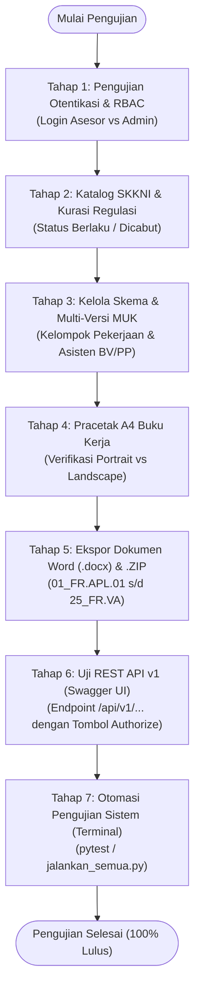

# Panduan Alur Pengujian Aplikasi (Testing Workflow)
## Sistem Pembuatan Dokumen Buku Kerja Asesor BNSP V.2023

Dokumen ini memuat skenario dan langkah kerja terstruktur untuk menguji seluruh fungsi sistem secara menyeluruh (*End-to-End Testing*), mencakup antarmuka web (GUI), tata letak pracetak A4, ekspor berkas Word/ZIP, integrasi REST API, hingga pengujian otomatis di terminal.

---

## 1. Peta Alur Pengujian (Workflow Diagram)



---

## 2. Matriks Akun Uji Coba

> **Kata sandi tidak lagi dicetak di aplikasi maupun di dokumen ini.**
> Sejak perbaikan keamanan, akun tidak dibuat dengan kata sandi publik. Saat
> basis data masih kosong, aplikasi membuat satu akun `admin` dengan kata sandi
> acak yang **ditampilkan sekali di konsol server** ketika `./run.sh` dijalankan.
> Setelah masuk pertama kali, aplikasi memaksa Anda menggantinya lewat halaman
> **Ganti Kata Sandi**. Akun asesor dibuat oleh admin (lihat `docs/KEAMANAN.md`).

| Peran | Username | Kata sandi | Deskripsi Tugas |
| :--- | :--- | :--- | :--- |
| **Kurator Master (Admin)** | `admin` | acak, tampil sekali di konsol saat instalasi | Mengelola dokumen SKKNI, kurasi status regulasi Kemnaker, unggah skema, koreksi unit, manajemen API Key. |
| **Penyusun Skema / Asesor** | dibuat admin | dibuat admin | Menyusun MUK & kelompok pekerjaan, ekstraksi, verifikasi manual, cetak & ekspor dokumen. |
| **API Client Eksternal** | *API Key* | dibuat lewat `python -m tools.kunci_api buat --nama "..."` | Sinkronisasi MUK ke plugin WordPress LSP atau SIMLSP. |

Kunci API yang dulu tercantum di panduan ini (`skkni_live_secret_key_...`) sudah
**dicabut** dan akan dibalas `401`. Buat kunci baru dengan perintah di atas; nilai
kuncinya hanya ditampilkan sekali.

---

## 3. Langkah Kerja Pengujian Terinci

### Tahap 1: Pengujian Otentikasi & Hak Akses (RBAC)
1. **Buka Aplikasi**: Akses [http://127.0.0.1:8000/](http://127.0.0.1:8000/).
2. **Uji Login Asesor**:
   - Klik tombol **"Masuk"** di pojok kanan atas (atau buka `/login`).
   - Masukkan username dan kata sandi akun asesor Anda (dibuat oleh admin).
   - **Hasil yang Diharapkan**: Berhasil masuk, di pojok kanan atas muncul nama akun dengan badge hijau `ASESOR` dan tombol *"Keluar"*.
3. **Uji Penolakan Tanpa Sesi**:
   - Keluar dulu, lalu buka `/skema` di jendela penyamaran (tanpa sesi).
   - Klik salah satu tombol tindakan, misalnya **Ekstrak**.
   - **Hasil yang Diharapkan**: Dialihkan ke halaman login dengan pesan bahwa tindakan tersebut memerlukan akun. Setelah masuk, Anda dikembalikan ke halaman sebelumnya.
4. **Uji Ganti Akun Admin**:
   - Klik tombol *"Keluar"* (Logout).
   - Masuk kembali menggunakan akun admin.
   - **Hasil yang Diharapkan**: Header menampilkan badge kuning `ADMIN`. Bila akun admin masih memakai kata sandi bawaan lama, aplikasi langsung membuka halaman **Ganti Kata Sandi** dan menahan tindakan lain sampai kata sandi diganti.
5. **Uji Pembatasan Peran**:
   - Masuk sebagai asesor, lalu coba `POST /skkni/upload` (unggah SKKNI) dari halaman.
   - **Hasil yang Diharapkan**: Ditolak dengan pesan bahwa tindakan hanya untuk peran admin.

---

### Tahap 2: Katalog SKKNI & Kurasi Regulasi Kemnaker
1. **Buka Menu Dokumen SKKNI**: Akses [http://127.0.0.1:8000/skkni](http://127.0.0.1:8000/skkni).
   - **Hasil yang Diharapkan**: Kolom *"Status Kemnaker"* tampil dengan badge hijau `✓ Berlaku` atau merah `⛔ Dicabut`.
2. **Uji Kurasi Status Regulasi (Khusus Admin)**:
   - Klik salah satu SKKNI (misal: *Broadcasting TV*).
   - Gulir ke panel bawah **"Kurasi Status Regulasi SKKNI"**.
   - Pilih opsi **"⛔ Dicabut / Digantikan"**, isi nomor Kepmenaker pengganti (misal: `KEP.999/MEN/2026`), lalu klik tombol **"Simpan Perubahan Regulasi"**.
   - **Hasil yang Diharapkan**: Notifikasi hijau sukses muncul, dan status langsung berubah menjadi `⛔ Dicabut` beserta rujukan Kepmen pengganti.

---

### Tahap 3: Pengelompokan Pekerjaan & Multi-Versi MUK
1. **Buka Skema Sertifikasi**: Akses [http://127.0.0.1:8000/skema](http://127.0.0.1:8000/skema).
2. **Buka Editor MUK**: Klik tombol **"Kelola Buku Kerja MUK"** pada skema yang tersedia (misal *Social Media Marketing*).
3. **Uji Fitur Multi-Versi**:
   - Perhatikan kotak dropdown **"Versi MUK:"** di bagian atas.
   - Pilihan varian paket MUK (misal *Versi 1 - Draf Awal MUK*) aktif dari database SQLite.
4. **Uji Kelompok Pekerjaan**:
   - Pastikan setiap unit kompetensi terpetakan ke kelompok kerja (misal: *Kelompok 1: Pengelolaan Konten & Media Sosial*).
   - Indikator cakupan unit menampilkan `100% (Semua unit telah terpetakan)`.
5. **Uji Asisten BV & PP (Generator 1-Klik)**:
   - Klik tombol **"Tarik dari Batasan Variabel SKKNI"** pada instrumen `FR.IA.02`. Daftar peralatan dan perlengkapan otomatis terisi dari SKKNI.
   - Klik tombol **"Tarik dari Aspek Kritis & Sikap SKKNI"** pada instrumen `FR.IA.03` / `FR.IA.06` / `FR.IA.07`. Draf pertanyaan dan kunci jawaban otomatis terisi.
6. **Simpan Konfigurasi MUK**: Klik tombol **"Simpan Seluruh Konfigurasi MUK"**.
   - **Hasil yang Diharapkan**: Notifikasi tersimpan muncul dan data tersimpan aman di SQLite `muk_versi` serta file JSON.

---

### Tahap 4: Pracetak Buku Kerja & Ukuran Kertas A4 (BNSP V.2023)
1. **Buka Halaman Cetak Buku Kerja**:
   - Dari editor MUK, klik tombol **"Cetak Buku Kerja (HTML)"** atau langsung buka:
     [http://127.0.0.1:8000/skema/ad086999cce24093ae152b7bb4f51240/cetak-apl?doc=all](http://127.0.0.1:8000/skema/ad086999cce24093ae152b7bb4f51240/cetak-apl?doc=all)
2. **Verifikasi Orientasi Layar**:
   - Formulir teks (`FR.APL.01`, `FR.APL.02`, `FR.AK.01`) tampil tegak sebagai **A4 Portrait (210 mm)**.
   - Formulir tabel lebar (`FR.MAPA.01`, `Peta Kelompok Pekerjaan`, `FR.MAPA.02`, `FR.IA.01`) otomatis **melebar utuh sebagai A4 Landscape (297 mm)**.
3. **Uji Filter Mode Dokumen & Metode**:
   - Ubah dropdown dokumen ke **"Observasi Langsung (CLO + TPD + PMO)"** atau **"FR.MAPA.01"**.
   - **Hasil yang Diharapkan**: Halaman otomatis menyaring dan hanya menampilkan paket formulir yang dipilih.
4. **Uji Fitur Cetak Browser (`Ctrl + P`)**:
   - Tekan `Ctrl + P` pada keyboard.
   - Periksa print preview: Browser otomatis memilih layout A4 dan menyesuaikan lembar landscape tanpa memotong kolom tabel.

---

### Tahap 5: Ekspor Berkas Word (.docx) & Arsip .ZIP
1. **Uji Ekspor Word (.docx)**:
   - Pada bar atas halaman cetak, klik tombol hijau **"Unduh .DOCX"**.
   - Buka berkas `.docx` yang terunduh di Microsoft Word atau LibreOffice.
   - **Hasil yang Diharapkan**: Dokumen rapi, tabel bergaris presisi, dan halaman otomatis berpindah orientasi (Landscape saat MAPA/IA.01 dan Portrait saat formulir teks).
2. **Uji Ekspor Bundel .ZIP**:
   - Klik tombol ungu **"Unduh .ZIP"**.
   - Ekstrak berkas `.zip`.
   - **Hasil yang Diharapkan**: Berisi berkas-berkas Word satuan bernomor urut resmi:
     - `01_FR.APL.01_Permohonan_Sertifikasi_Kompetensi.docx`
     - `02_FR.APL.02_Asesmen_Mandiri.docx`
     - `04_FR.MAPA.01_Merencanakan_Aktivitas_dan_Proses_Asesmen.docx` *(Landscape)*
     - `05c_Peta_Kelompok_Pekerjaan.docx` *(Landscape)*
     - `06_FR.MAPA.02_Peta_Instrumen_Asesmen.docx` *(Landscape)*
     - `10_FR.IA.01_CL_Ceklis_Observasi_Aktivitas.docx` *(Landscape)*
     - `11_FR.IA.02` s/d `25_FR.VA.docx` (termasuk formulir kosongan `FR.VA`).
     - `00_Buku_Kerja_Lengkap_Gabungan.docx`.

---

### Tahap 6: Pengujian REST API v1 Terintegrasi (Swagger UI)
1. **Buka Swagger UI**: Akses [http://127.0.0.1:8000/docs](http://127.0.0.1:8000/docs).
2. **Otentikasi Kunci API**:
   - Buat kunci lebih dulu di terminal:
     ```bash
     .venv/bin/python -m tools.kunci_api buat --nama "Uji Swagger" --peran klien
     ```
   - Salin nilai kunci yang tampil sekali tersebut.
   - Klik tombol **"Authorize"** di pojok kanan atas Swagger UI.
   - Pada field `X-API-Key`, tempelkan nilai kunci tadi, lalu **Authorize** → **Close**.
   - **Catatan**: kunci bawaan lama (`skkni_live_secret_key_...`) sudah dicabut dan dibalas `401`.
3. **Uji Coba Endpoint**:
   - **`GET /api/v1/status`**: Klik *Try it out* -> *Execute*. Response mengembalikan status `200 OK` dengan informasi klien *"WordPress LSP Plugin"*.
   - **`GET /api/v1/skkni`**: Response mengembalikan daftar dokumen SKKNI beserta status regulasi Kemnaker.
   - **`GET /api/v1/skema/{schema_id}/muk`**: Masukkan ID skema `ad086999cce24093ae152b7bb4f51240` -> Response mengembalikan JSON siap sinkronisasi untuk WordPress LSP (Kelompok Pekerjaan, Instrumen IA.01–11, dan referensi BV/PP).
   - **`POST /api/v1/documents/render`**: Kirim payload JSON untuk merender formulir ke HTML atau DOCX dari aplikasi eksternal.

---

### Tahap 7: Otomasi Pengujian Sistem (Unit Testing di Terminal)
Jalankan pengujian terpadu langsung dari terminal proyek menggunakan `pytest` atau script runner terpadu:

```bash
cd /home/muhadi/Projects/skkni-extractor
# Menggunakan pytest:
.venv/bin/pytest

# Atau menggunakan runner pengujian terpadu (mode isolasi subprocess):
.venv/bin/python tests/jalankan_semua.py
```

**Kriteria Keberhasilan**:
- Seluruh rangkaian test otomatis (mencakup proteksi otorisasi POST, SQLite WAL, isolasi basis data, multi-versi MUK, REST API v1, template pracetak A4, generator docx, hingga validasi hash) berjalan dan berstatus **LULUS / PASS** tanpa error.

---

## 4. Lembar Ceklis Pengujian Mandiri (Testing Checklist)

| No | Modul / Fitur | Status Uji | Catatan / Hasil |
| :---: | :--- | :---: | :--- |
| 1 | Login asesor (akun buatan admin) | [ ] Lulus | Hak akses terbatas; aksi kurasi admin ditolak | 
| 2 | Login admin | [ ] Lulus | Akses penuh termasuk kurasi regulasi SKKNI |
| 3 | Perubahan status regulasi SKKNI Kemnaker | [ ] Lulus | Badge Berlaku / Dicabut terupdate |
| 4 | Pemetaan unit ke Kelompok Pekerjaan | [ ] Lulus | Indikator cakupan unit 100% |
| 5 | Asisten BV & PP generator 1-klik | [ ] Lulus | Alat, bahan, dan pertanyaan terisi otomatis |
| 6 | Penyimpanan Multi-Versi Paket MUK | [ ] Lulus | Tersimpan terpisah di SQLite `muk_versi` |
| 7 | Tampilan layar A4 Portrait (210mm) | [ ] Lulus | APL.01, APL.02, AK, IA.02 s/d VA |
| 8 | Tampilan layar A4 Landscape (297mm) | [ ] Lulus | MAPA.01, Peta Kelompok, MAPA.02, IA.01 |
| 9 | Cetak Browser (`Ctrl + P`) A4 Otomatis | [ ] Lulus | Halaman tabel tidak terpotong |
| 10 | Unduh berkas Word (.docx) & .ZIP urut | [ ] Lulus | Berkas 01 s/d 25 tersusun rapi |
| 11 | REST API v1 & Swagger UI di `/docs` | [ ] Lulus | Autentikasi `X-API-Key` & tombol Authorize bekerja |
| 12 | Seluruh Rangkaian Tests di Terminal | [ ] Lulus | `pytest` / `jalankan_semua.py` berjalan serempak |
| 13 | Proteksi Endpoint POST Tanpa Sesi | [ ] Lulus | Seluruh POST ditolak/303 ke login; asesor ditolak 403 pada admin-only |
| 14 | Konsistensi Multi-Versi MUK Aktif | [ ] Lulus | Tepat satu versi berstatus [Aktif] pada dropdown & basis data |
| 15 | Proteksi Integritas Data saat Test | [ ] Lulus | Checksum `data/app.db` tetap utuh sebelum dan sesudah pengujian |
