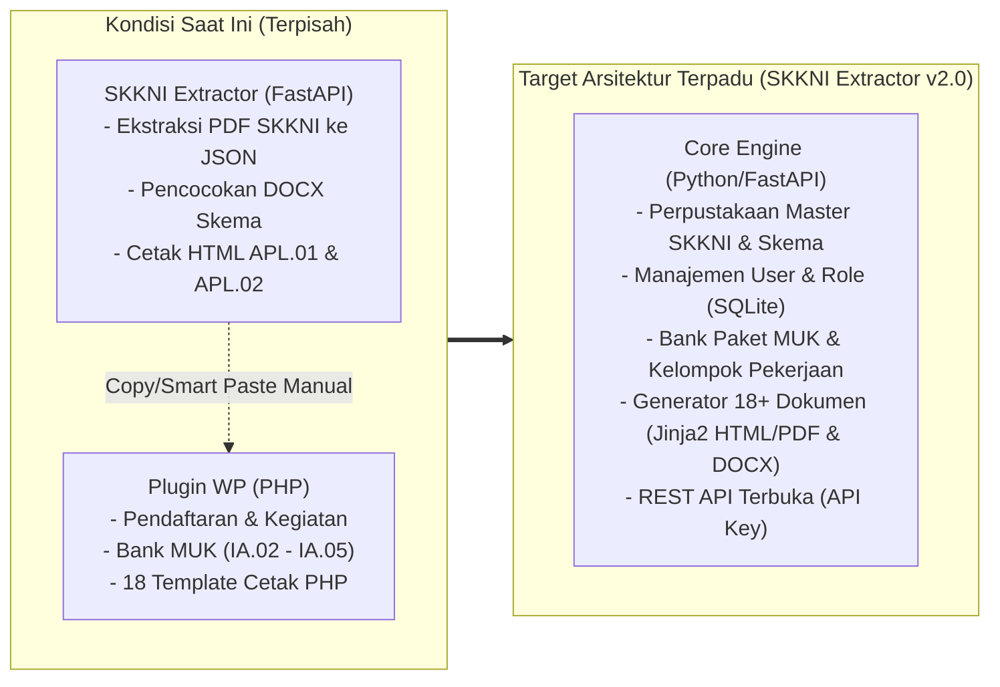

# Rencana Pengembangan Sistem Pembuatan Dokumen Buku Kerja Asesor & MUK (Standar BNSP V.2023)

**Dokumen Acuan untuk:**
1. **Tim Tenaga Ahli Sertifikasi / Master Asesor** (Validasi aturan bisnis, alur dokumen BNSP, dan kelengkapan instrumen MUK)
2. **Tim Web Programmer** (Validasi arsitektur teknis, struktur database, integrasi template, dan pengembangan REST API)

---

## 1. Latar Belakang & Tujuan Proyek

Saat ini terdapat dua sistem yang berjalan secara terpisah:
1. **SKKNI Extractor (Python / FastAPI):** Berfungsi mengekstrak dokumen PDF SKKNI dan DOCX Skema Sertifikasi menjadi data JSON terstruktur (Unit Kompetensi, Elemen Kompetensi, Kriteria Unjuk Kerja/KUK, Batasan Variabel, dan Panduan Penilaian).
2. **Plugin WordPress (`lsp-certification-management`):** Berfungsi mengelola pendaftaran asesi, penjadwalan kegiatan, bank instrumen MUK, serta pencetakan 18+ formulir sertifikasi BNSP.

**Tujuan Pengembangan:**
Menggabungkan kemampuan **Generator Dokumen Sertifikasi & Bank Instrumen MUK** dari plugin WordPress langsung ke dalam aplikasi **SKKNI Extractor**, namun dalam **versi ramping (Tanpa Sistem Pendaftaran Peserta)**. 

Output akhirnya adalah **Dokumen Master / Blanko Siap Cetak (Ready-to-Print)** untuk seluruh perangkat asesmen (APL, MAPA, AK, IA) yang akan diisi secara manual oleh peserta (asesi) dan asesor di lapangan, sementara data skema, unit kompetensi, elemen, KUK, serta identitas asesor langsung terisi otomatis dari aplikasi.

---

## 2. Bagian A — Untuk Ditinjau oleh Tenaga Ahli Sertifikasi (Asesor / Komite Skema)

> **PENTING:** Mohon Tenaga Ahli memeriksa apakah pemetaan dokumen, aturan pengisian otomatis vs manual, serta struktur instrumen di bawah ini sudah sesuai dengan pedoman BNSP V.2023 dan SOP LSP.

### 2.1. Konsep Dokumen "Template Siap Cetak" (Tanpa Data Pendaftaran Asesi)
Karena aplikasi ini tidak memproses pendaftaran peserta secara online:
- **Bagian yang Terisi Otomatis oleh Sistem:**
  - Judul Skema, Nomor Skema, dan Jenis Kemasan (KKNI / Okupasi / Klaster).
  - Daftar Unit Kompetensi (Kode Unit, Judul Unit, dan Standar Acuan SKKNI).
  - Rincian Elemen Kompetensi dan Kriteria Unjuk Kerja (KUK) secara lengkap pada `FR.APL.02` dan `FR.IA.01`.
  - Pengelompokan Unit berdasarkan **Kelompok Pekerjaan** pada `FR.IA.01`, `FR.IA.02`, dan `FR.IA.03`.
  - Identitas **Asesor Penguji** (Nama & No. Reg. MET), **Tim Penyusun**, **Validator**, dan **Manajer Sertifikasi** (diinput melalui aplikasi).
- **Bagian yang Dikosongkan (Blanko untuk Diisi Manual / Tulis Tangan):**
  - Identitas Asesi (Nama lengkap, NIK, tempat/tgl lahir, alamat, pekerjaan, tanda tangan).
  - Kotak pencapaian/asesmen mandiri (`☐ K` / `☐ BK` pada `FR.APL.02`, serta `☐ Ya` / `☐ Tidak` pada `FR.IA.01` & `FR.IA.03`).
  - Kolom bukti relevan, tanggapan asesi, umpan balik, catatan asesor, dan rekomendasi akhir.

### 2.2. Daftar Dokumen yang Akan Dihasilkan Sistem
Mengacu pada paket dokumen acuan (contoh: *Skema Videografer*) dan template yang sudah ada di sistem sebelumnya, berikut adalah rincian formulir yang akan didukung:

| No | Kode Dokumen | Nama Dokumen | Sumber Data Utama | Metode Pengisian Asesi/Hasil |
| :--- | :--- | :--- | :--- | :--- |
| 1 | **Cover & Ceklis** | Cover & Daftar Periksa Kelengkapan Dokumen | Metadata Skema | Ceklis Manual |
| 2 | **FR.APL.01** | Permohonan Sertifikasi Kompetensi | Metadata Skema + Daftar Unit + Syarat Dasar/Admin | Biodata & TTD Asesi Kosong (`.....`) |
| 3 | **FR.APL.02** | Asesmen Mandiri | Unit + **Elemen + KUK Lengkap** dari Ekstraksi SKKNI | Checkbox `☐ K` / `☐ BK` & Bukti Kosong |
| 4 | **FR.MAPA.01 (Obs)** | Merencanakan Aktivitas & Proses Asesmen *(Observasi Langsung)* | Unit Skema + Matriks Otomatis (`L`, `T`, `CLO`, `DPT`) | Kategori Asesi 1 atau 2 (Bisa dipilih/kosong) |
| 5 | **FR.MAPA.01 (DIT)** | Merencanakan Aktivitas & Proses Asesmen *(DIT / Kegiatan Terstruktur)* | Unit Skema + Matriks Otomatis (`L`, `T`, `DIT`, `DPT`) | Kategori Asesi 1 atau 2 (Bisa dipilih/kosong) |
| 6 | **FR.MAPA.01 (Port)** | Merencanakan Aktivitas & Proses Asesmen *(Verifikasi Portofolio)* | Unit Skema + Matriks Otomatis (`TL`, `T`, `CVP`, `DPT`) | Kategori Asesi 3, 4, atau 5 (Bisa dipilih/kosong) |
| 7 | **FR.MAPA.02** | Peta Instrumen Asesmen | Unit Skema + Tabel 11 Instrumen (`FR.IA.01`–`FR.IA.11`) | Checkbox Potensi Asesi (1–5) |
| 8 | **FR.AK.01** | Persetujuan Asesmen dan Kerahasiaan | Metadata Skema, TUK, Nama Asesor | Nama/TTD Asesi & Bukti Kosong |
| 9 | **FR.AK.02** | Rekaman Asesmen Kompetensi | Daftar Unit Skema + Matriks Jenis Bukti | Checkbox Bukti & Rekomendasi Kosong |
| 10 | **FR.AK.03** | Umpan Balik dan Catatan Asesmen | Komponen Umpan Balik Standar BNSP | Checkbox Ya/Tidak & Catatan Kosong |
| 11 | **FR.AK.04** | Banding Asesmen | Daftar Unit Skema + Klausul Banding | Isian Alasan Banding Kosong |
| 12 | **FR.AK.05** | Laporan Asesmen | Metadata Skema, TUK, Asesor + Tabel Daftar Asesi | Tabel Nama Asesi & K/BK Kosong |
| 13 | **FR.AK.06** | Meninjau Proses Asesmen | Matriks Dimensi Kompetensi (`TS, TMS, CMS, JRES, TRS`) | Isian Evaluasi Proses Kosong |
| 14 | **FR.AK.07** | Ceklis Penyesuaian yang Wajar dan Beralasan | Daftar Potensi & Kebutuhan Penyesuaian | Checkbox & Hasil Penyesuaian Kosong |
| 15 | **FR.IA.01** | CL - Ceklis Observasi Aktivitas Praktik | **Kelompok Pekerjaan** + **Elemen & KUK Lengkap** | Checkbox `☐ Ya` / `☐ Tidak` Kosong |
| 16 | **FR.IA.02** | TPD - Tugas Praktik Demonstrasi | **Kelompok Pekerjaan** + Bank Instrumen IA.02 (Skenario, Langkah, Alat, Durasi) | Siap pakai untuk instruksi praktik |
| 17 | **FR.IA.03** | PMO - Pertanyaan Mendukung Observasi | **Kelompok Pekerjaan** + Bank Pertanyaan IA.03 (`CMS, TRS, JRES, TS, TMS`) | Ruang Tanggapan Asesi & `☐ Ya/Tdk` Kosong |
| 18 | **FR.IA.04A & 04B** | DIT - Penjelasan Proyek Singkat (STAR) & Lembar Penilaian | Bank Instrumen IA.04 (Situasi, Tugas, Tindakan, Hasil + Pertanyaan) | Checkbox Pencapaian `☐ Ya/Tdk` Kosong |
| 19 | **FR.IA.05A, B, C** | DPT - Soal Pilihan Ganda, Kunci Jawaban, & Lembar Jawaban | Bank Soal IA.05 per Skema/Paket MUK | Lembar Jawaban (05C) Kosong untuk Asesi |

### 2.3. Poin Konfirmasi untuk Tenaga Ahli
1. **Kelompok Pekerjaan (`FR.IA.01`, `FR.IA.02`, `FR.IA.03`):**
   - Apakah aturan wajib **100% unit kompetensi harus masuk ke dalam Kelompok Pekerjaan** sebelum `IA.01–03` bisa dicetak tetap diberlakukan seperti di plugin WordPress?
   - Apakah satu skema hanya memiliki 1 susunan Kelompok Pekerjaan, atau bisa berbeda per Paket MUK?
2. **Pemanfaatan Batasan Variabel & Panduan Penilaian dari SKKNI:**
   - Aplikasi `SKKNI Extractor` sudah berhasil mengekstrak **Batasan Variabel (BV)** dan **Panduan Penilaian (PP)** dari PDF SKKNI secara akurat. Apakah Tenaga Ahli ingin data BV/PP ini ditampilkan sebagai referensi otomatis saat menyusun skenario `FR.IA.02` (peralatan/perlengkapan) dan pertanyaan `FR.IA.03` (aspek kritis/dimensi kompetensi)?
3. **Format Luaran (Output):**
   - Apakah untuk keperluan lapangan cukup dengan fitur **Cetak Langsung / Simpan PDF dari Browser** (ukuran presisi A4), atau Tenaga Ahli juga membutuhkan unduhan dalam bentuk **berkas Microsoft Word (`.docx`)** untuk masing-masing formulir?

---

## 3. Bagian B — Untuk Ditinjau oleh Web Programmer

> **CATATAN TEKNIS:** Bagian ini menjelaskan kondisi kode saat ini (`skkni-extractor` & `lsp-certification-management`) serta arsitektur teknis untuk proses penggabungan, manajemen multi-user, dan penyediaan REST API.

### 3.1. Arsitektur Sistem Saat Ini vs Target Pengembangan

### 3.2. Peta Modul Kode yang Sudah Ada (Modal Awal)
Programmer tidak perlu membangun dari nol. Berikut adalah aset kode yang sudah tersedia di kedua repositori:
1. **Di Repositori `skkni-extractor` (`/home/muhadi/Projects/skkni-extractor`):**
   - `app/extractor.py`, `app/unit_parser.py`, `app/section_parser.py`: Mesin ekstraksi PDF SKKNI ke JSON.
   - `app/schema_parser.py` & `app/schema_library.py`: Pembaca tabel unit dari `.docx` skema dan manajemen metadata skema.
   - `app/buku_kerja.py` & `app/templates/cetak_apl.html`: Fondasi penyusun data cetak dan template Jinja2 untuk `FR.APL.01` & `FR.APL.02` versi blanko.
   - `app/lsp_exporter.py`: Konverter unit JSON ke struktur array standar LSP.
2. **Di Repositori Plugin WordPress (`/var/www/html/wordpress/wp-content/plugins/lsp-certification-management`):**
   - `templates/docs/document-layout.php` & `form-*.php` (18 file): Seluruh struktur tabel HTML & CSS `@media print` standar A4 BNSP yang sudah lulus audit tampilan.
   - `includes/class-kelompok-pekerjaan.php`: Logika validasi cakupan 100% unit kompetensi dan *rowspan* tabel kelompok pekerjaan.
   - `includes/class-paket-muk.php`, `class-ia02.php`, `class-ia03.php`, `class-ia04.php`, `class-ia05.php`: Struktur data JSON untuk penyimpanan instrumen asesmen.

### 3.3. Langkah-Langkah Teknis Implementasi (Roadmap Programmer)

#### Fase 1: Migrasi Penyimpanan Metadata ke SQLite & Sistem Multi-User (RBAC)
Saat ini metadata disimpan sebagai file JSON di `data/`. Agar tidak berantakan saat digunakan banyak pengguna:
- Gunakan **SQLite (`data/app.db`)** menggunakan `SQLAlchemy` atau `sqlite3` bawaan Python (file PDF, DOCX, dan cache ekstraksi unit tetap di filesystem).
- Buat sistem autentikasi (Login Session + Password Hash `bcrypt`/`argon2`) dengan pembagian Role:
  - **`admin` (Kurator Master):** Mengelola Master PDF SKKNI, memverifikasi ekstraksi unit, dan menerbitkan Master Skema Resmi.
  - **`asesor` / `penyusun`:** Hanya *Read-Only* terhadap Master SKKNI. Memiliki profil pribadi (`nama_lengkap`, `no_reg_met`) yang otomatis terisi saat mencetak dokumen. Dapat membuat/mengelola **Paket MUK** atau draf skema di ruang kerjanya sendiri tanpa mengotori Master Skema milik user lain.

#### Fase 2: Pembuatan Modul Kelompok Pekerjaan & Bank Instrumen MUK
Menambahkan tabel/penyimpanan konfigurasi per Skema (dan mendukung multi-versi Paket MUK):
1. **Metadata Tambahan Skema:** Nomor Skema, Jenis Skema, Persyaratan Dasar, Persyaratan Administratif, Nama Penyusun, MET Penyusun, Nama Validator, MET Validator, Nama Manajer Sertifikasi.
2. **Kelompok Pekerjaan:** Struktur `[{id, nama, urutan, units: [kode_unit, ...]}]` beserta fungsi `validate_coverage()` (porting dari `class-kelompok-pekerjaan.php`).
3. **Bank Instrumen (`ia02`, `ia03`, `ia04`, `ia05`):**
   - Porting struktur data dan nilai *default* dari `class-ia02.php` s/d `class-ia05.php` ke modul Python `app/services/muk_service.py`.
   - Membuat antarmuka web (UI) di halaman Detail Skema untuk mengatur Kelompok Pekerjaan dan mengisi instrumen IA.02–IA.05.

#### Fase 3: Konversi 18 Template Dokumen PHP ke Jinja2
Mengonversi file `templates/docs/form-*.php` dari plugin WordPress menjadi komponen Jinja2 di `app/templates/docs/`:
- `base_print.html` (dari `document-layout.php`)
- `form_apl01.html` & `form_apl02.html` (sudah ada di `cetak_apl.html`, tinggal dimodularisasi)
- `form_mapa01.html` (mendukung parameter `metode`: `observasi`, `dit`, `portofolio` + filter interaktif Kategori Asesi 1–5)
- `form_mapa02.html`
- `form_ak01.html` s/d `form_ak07.html`
- `form_ia01.html`, `form_ia02.html`, `form_ia03.html`, `form_ia04a.html`, `form_ia04b.html`, `form_ia05a.html`, `form_ia05b.html`, `form_ia05c.html`
- Mendukung mode cetak satuan maupun **`bundle_all` (1 klik cetak seluruh berkas 1 s/d selesai)**.

#### Fase 4: Penyediaan REST API untuk Integrasi Aplikasi Lain
Membuka endpoint API berstandar OpenAPI/Swagger (`/api/v1/...`) dengan pengamanan **API Key (`X-API-Key`)**:
1. `GET /api/v1/skkni` & `GET /api/v1/skkni/{kode_unit}` — Mengambil data unit, elemen, KUK, batasan variabel, dan panduan penilaian dalam format JSON.
2. `GET /api/v1/skema` & `GET /api/v1/skema/{id}/muk` — Mengambil struktur lengkap skema beserta daftar unit, kelompok pekerjaan, dan instrumen IA untuk disinkronkan ke WordPress atau aplikasi eksternal lainnya.
3. `POST /api/v1/documents/render` — Menerima payload JSON (misal: `schema_id`, `doc_type`, `asesor`, dan opsional `asesi` jika dipanggil dari aplikasi pendaftaran eksternal) dan mengembalikan HTML siap cetak atau file dokumen.

---

## 4. Daftar Periksa Keputusan (Checklist Diskusi Tim)

Silakan gunakan tabel singkat ini saat rapat bersama Web Programmer dan Tenaga Ahli:

- [ ] **Keputusan 1 (Tenaga Ahli):** Apakah seluruh 18 jenis dokumen di atas sudah mencakup semua kebutuhan cetak fisik asesmen, atau ada tambahan (seperti `FR.IA.06` Esai / `FR.IA.07` Lisan / `FR.IA.08` Portofolio)?
- [ ] **Keputusan 2 (Tenaga Ahli):** Apakah tanggal pada dokumen cetak (`APL`, `MAPA`, `AK`, `IA`) sebaiknya dikosongkan (`.................`) agar ditulis tangan, atau bisa dipilih tanggalnya saat hendak menekan tombol cetak?
- [ ] **Keputusan 3 (Kebijakan Akses):** Apakah pengguna luar bisa melihat & mencetak dari Skema Resmi tanpa login (mode tamu), atau wajib login untuk semua pengguna?
- [ ] **Keputusan 4 (Programmer):** Apakah integrasi dengan WordPress ke depannya akan menggunakan tarik data otomatis via REST API (`GET /api/v1/skema/{id}/muk`) menggantikan fitur *Smart Paste* manual?
